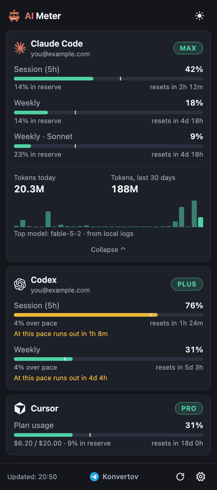
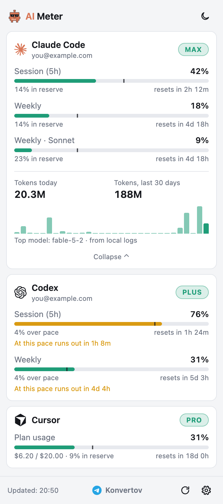
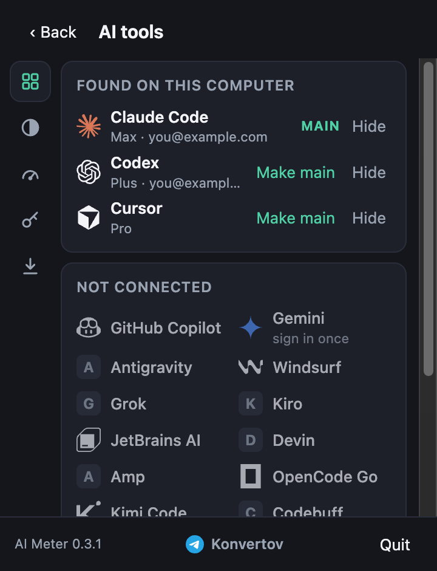
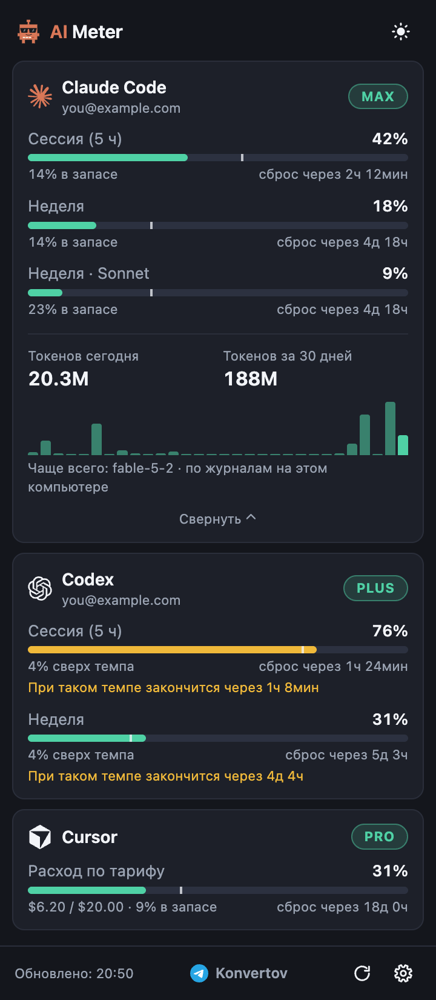

<p align="center">
  
</p>

<h1 align="center">AI Meter</h1>

<p align="center">
  <b>All your AI limits in one place — before they run out.</b><br>
  A free menu bar and tray app for macOS and Windows.
</p>

<p align="center">
  <a href="https://github.com/Konvertov/ai-meter/releases/latest"></a>
  
  
  <a href="LICENSE"></a>
  <a href="https://t.me/konvertov"></a>
</p>

<p align="center">
  <a href="#download">Download</a> ·
  <a href="#features">Features</a> ·
  <a href="#supported-ai-tools">Supported tools</a> ·
  <a href="#privacy">Privacy</a> ·
  <a href="#build-from-source">Build</a> ·
  <a href="#по-русски">По-русски</a>
</p>

<p align="center">
  
  &nbsp;&nbsp;
  
</p>

AI Meter finds the AI tools you already use — Claude Code, Codex, Cursor, GitHub Copilot, Gemini and more — and shows how much of each limit is spent, how much is left and when it resets. No more opening every tool to check whether you can keep working.

## Download

**[Latest release →](https://github.com/Konvertov/ai-meter/releases/latest)**

| System | File | First start |
| --- | --- | --- |
| macOS 11 or newer (Apple Silicon and Intel) | `AI.Meter_*_universal.dmg` | Drag AI Meter to Applications. The first time, right-click the app and choose **Open**. |
| Windows 10 or 11 | `AI.Meter_*_x64-setup.exe` | Run the installer. If you see “Windows protected your PC”, click **More info → Run anyway**. Installs for your user only, no admin rights needed. |

New versions install themselves, quietly, while the panel is closed.

## Features

- **Finds your tools on its own.** If a supported tool is installed and signed in, its card simply appears. Nothing to type in.
- **Every limit at a glance.** Session, weekly and monthly limits as bars, with a countdown to each reset. The current session is shown right next to the icon: as a number in the macOS menu bar, as Kvadrik's charge cells in the Windows tray.
- **Pace and warnings.** A mark on each bar shows where an even pace would be. Spending faster than that? AI Meter tells you when the limit will run out.
- **Token stats for Claude Code.** Tokens today and over 30 days, a bar per day and your most used model — counted on your computer from Claude Code's own logs.
- **Your setup.** Pick the main tool, fold or hide the others, show limits as spent or as left, light or dark theme, English or Russian, 12- or 24-hour clock.
- **Quiet.** Lives in the menu bar or tray, refreshes every few minutes and never gets in the way.

<p align="center">
  
</p>

## Supported AI tools

| Tool | How AI Meter finds it |
| --- | --- |
| Claude Code | the Claude Code sign-in on this computer |
| Codex (ChatGPT) | the Codex CLI sign-in |
| Cursor | the Cursor editor sign-in |
| GitHub Copilot | the GitHub CLI sign-in |
| Antigravity | the running Antigravity app |
| Windsurf | the Windsurf editor (the last numbers it saved) |
| Grok | the Grok CLI sign-in |
| Kiro | the Kiro editor (the last numbers it saved) |
| JetBrains AI | any JetBrains IDE with AI Assistant |
| Devin | the Devin CLI or app sign-in |
| Amp | the Amp CLI sign-in |
| OpenCode Go | the OpenCode sign-in |
| Kimi Code | the Kimi CLI sign-in |
| Codebuff | the Codebuff CLI sign-in |
| Gemini | sign in once in a window inside AI Meter |
| OpenRouter | API key |
| DeepSeek | API key |
| abliteration.ai | API key |

The list grows with every version.

## Privacy

- **No server of ours.** AI Meter talks only to the AI services themselves. Nothing in between, no accounts, no statistics.
- **Sign-ins are only read.** The app reads the sign-in your tools already saved. It never changes it, copies it anywhere or renews it — so it can never sign you out of your tools.
- **Keys stay on your computer.** API keys you add are kept locally: in the system credential store on Windows, in a file only your user can read on macOS.
- **Open source.** Every line is here to check.

## Build from source

Needs [Node.js](https://nodejs.org) 22+ and [Rust](https://rustup.rs) stable. On Windows also the Visual Studio Build Tools with the C++ workload.

```sh
npm ci
npm run tauri build
```

The app is built with [Tauri 2](https://tauri.app): Rust for reading the limits, plain TypeScript and CSS for the panel (no framework).

| Path | What is there |
| --- | --- |
| `src-tauri/src/providers/` | one file per AI tool: where its sign-in lives and how its limits are read |
| `src-tauri/src/lib.rs` | refreshing, the tray / menu bar icon, the panel window |
| `src-tauri/src/icon.rs` | Kvadrik, drawn for the menu bar and the tray |
| `src/` | the panel itself: `main.ts`, `i18n.ts` (English and Russian), `style.css` |

Useful while working on it:

- `aimeter --json` prints what every service returned, without opening a window.
- `AIMETER_DEMO=3` shows a preview with three services.

Bug reports and ideas are welcome in [Issues](https://github.com/Konvertov/AImeter/issues).

## License

AI Meter is free software under the [GNU General Public License v3.0 or later](LICENSE), with [additional terms](NOTICE.md) allowed by its section 7:

- every copy or modified version must keep the visible author link **Konvertov → [t.me/konvertov](https://t.me/konvertov)** where the original shows it;
- modified versions must be marked as such and use their own name and icon — “AI Meter” and the Kvadrik character are not licensed as trademarks.

## Author

Made by **Konvertov** — news, updates and other projects in Telegram: **[t.me/konvertov](https://t.me/konvertov)**.

---

## По-русски

**AI Meter** — бесплатное приложение для macOS и Windows. Оно живёт в строке меню или в трее, само находит нейросети, которыми вы пользуетесь (Claude Code, Codex, Cursor, GitHub Copilot, Gemini и другие), и показывает, сколько израсходовано и осталось от каждого лимита и когда он сбросится.

<p align="center">
  
</p>

- **Скачать:** [последняя версия](https://github.com/Konvertov/ai-meter/releases/latest) — `.dmg` для macOS, `-setup.exe` для Windows.
- **macOS:** перетащите AI Meter в «Программы»; в первый раз нажмите на приложение правой кнопкой и выберите «Открыть».
- **Windows:** запустите установщик; если появится «Система Windows защитила ваш компьютер», нажмите «Подробнее» → «Выполнить в любом случае».
- **Приватность:** нет своего сервера и сбора статистики; входы других программ только читаются; API-ключи хранятся на вашем компьютере.
- **Интерфейс:** русский и английский, светлая и тёмная тема. Новые версии ставятся сами.

Лицензия — GNU GPL v3 с дополнительным условием: в любой копии и изменённой версии должна оставаться видимая ссылка на автора, [Konvertov в Telegram](https://t.me/konvertov). Подробнее — в [NOTICE.md](NOTICE.md).
